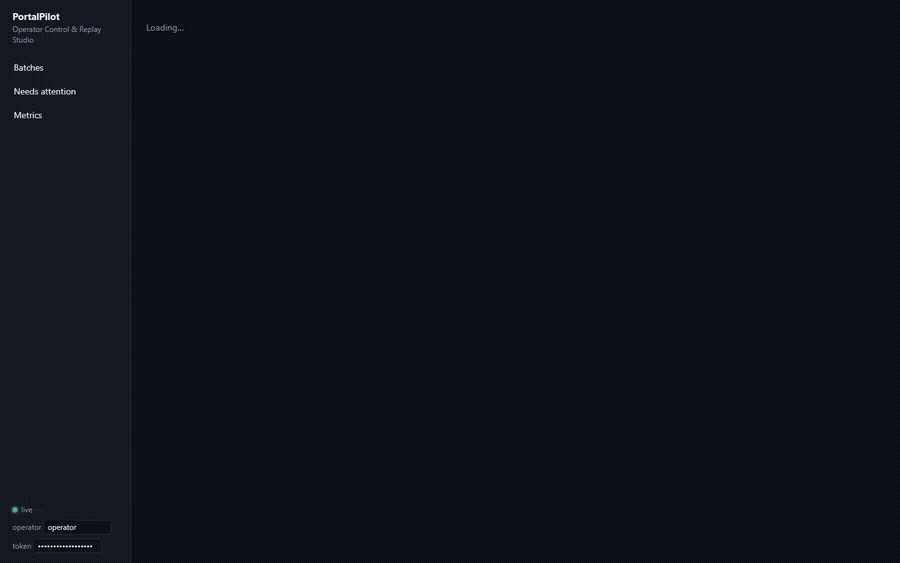

# PortalPilot

**An agent that files work into enterprise portals that have no API: durable, human-supervised, and unable to
submit the same thing twice.**

▶ **[Watch the 2-minute demo](docs/demo/portalpilot-demo.mp4)**: messy CSV in, MFA and an approval handled by a human, a hung
submit recovered without a second click, and my fine-tuned 2B model's misclick caught before it happened.



The scenario is a common FDE engagement. A client has a CSV of insurance claims and a legacy provider portal with
no API, MFA, pop-ups and maintenance pages, and today a person retypes every row. PortalPilot onboards the messy
CSV, drives real browsers through the portal, and hands the hard moments to a human: approvals, MFA, pages it
doesn't understand. It also keeps a replay of everything it saw and did.

```
CSV ─▶ onboarding (map · validate · idempotency key) ─▶ Temporal workflow per row ─▶ Playwright on ECS workers
                                                                │                          │
                                     approvals · MFA · takeover │        grounding: cache ─▶ fine-tuned Qwen2-VL-2B ─▶ Claude
                                                                ▼                          ▼     (every point verified against the DOM)
                                          React/TS Operator Control & Replay Studio ◀─ Postgres (steps · ledger · audit) + S3
```

**Stack:** Python 3.12 · FastAPI · Temporal · Playwright · PostgreSQL 16 · S3 · React 19 + TypeScript · Docker ·
Terraform (ECS Fargate, RDS, ALB, KMS, Secrets Manager, Cloud Map, CloudWatch) · vLLM serving my own GRPO-trained
Qwen2-VL-2B click policy ([ui_click_grpo](https://github.com/snehabasker/ui_click_grpo)) · Claude (`claude-opus-5-5`) as the fallback grounder.

Full blueprint (architecture, schema, workflow design, UI, operations): **[docs/ARCHITECTURE.md](docs/ARCHITECTURE.md)** ·
decisions and their alternatives: **[docs/adr](docs/adr/README.md)** · on-call, runbooks, postmortems:
**[docs/ops](docs/ops/README.md)** · client workshops: **[docs/workshops](docs/workshops/README.md)**

## Results

| | |
|---|---|
| My 2B click policy on a portal it never saw (69 controls, 3 viewports, pop-ups) | **91.3% verified clicks**. All 6 misses hit the label next to a text field; the verifier caught every one before anything was clicked. |
| Hostile end-to-end run (pop-ups, 503s, MFA on every login, a submit that commits then hangs 90 s) | 4/4 valid rows filed, **4 claims for 4 clicks**, the hung submit recovered by searching the portal (no re-click), 2 invalid rows stopped at onboarding |
| Who grounded the 99 actions in that run | Qwen 58 · cache 34 · fallback 7 |
| Worker SIGKILLed mid-batch | 3 in-flight tasks resumed on a new worker; still 4 claims for 4 clicks |
| Same CSV uploaded again | 0 tasks started |
| **Deployed to AWS** (ECS Fargate, RDS, KMS, ALB in eu-north-1), same hostile e2e run | all 8 checks pass: 4 claims for 4 clicks, hung submit reconciled |
| **Game day** (portal 503 storm, then worker killed mid-batch), against the full ops stack | first run: detected in 6 m 43 s and 3 m 22 s, 0 duplicates, and 4 weaknesses found (2 in the system, 2 in the monitoring). After the fixes: outage detected in **1 m 47 s**, 16 of 16 tasks succeeded, 16 claims for 16 clicks → [postmortem](docs/ops/postmortems/2026-11-06-game-day.md) |
| Tests | 37 backend (12 Temporal scenarios) · 9 Lambda tests on moto · 7 promtool alert-rule tests · 34 WCAG contrast checks · Helm chart on kind in CI |

Details and caveats: [docs/ARCHITECTURE.md § 6](docs/ARCHITECTURE.md#6-measured-results).

## What's interesting in here

* **Zero double-submits, with four independent layers.** A DB uniqueness constraint, Temporal workflow ids, a
  dedupe search *on the portal itself* before every submit, and a SQL state machine (`intent → in_flight`) the worker
  must win before it may click. A submit whose outcome is unknown is reconciled, never retried blind.
  ([workflows.py](backend/portalpilot/orchestration/workflows.py), [schema](backend/portalpilot/migrations/001_init.sql))
* **Tiered, verified perception.** A cheap model first, an expensive one only when the cheap one is *verifiably*
  wrong. The verifier (`elementFromPoint` + kind + accessible name + modal check) is the confidence signal.
  Verified points are cached by page structure, so a batch pays for each page once.
  ([grounding/](backend/portalpilot/grounding))
* **Humans as first-class workflow participants.** Approvals, MFA codes and full browser takeover are Temporal
  signals with deadlines. Waiting costs no compute. After a takeover the agent re-checks the portal before it may
  submit. ([Studio.tsx](frontend/src/pages/Studio.tsx))
* **Secrets never in workflow history.** Envelope-encrypted vault (KMS in AWS), credentials decrypted inside the
  activity, MFA codes passed by reference, a hash-chained append-only audit log.
* **Data onboarding.** Messy headers (`Pol #`, `DOL`, `Peril`) mapped by synonym, fuzzy match or optionally Claude,
  with every decision shown for review. Normalized dates, amounts and names; invalid rows kept with field errors.
  ([onboarding.py](backend/portalpilot/onboarding.py))
* **One-command, per-client AWS deploy.** Terraform with one tfvars file per client, least-privilege IAM, alarms.
* **Event-driven intake and notifications.** Drop a CSV in S3 → EventBridge → SQS (+DLQ) → Lambda starts the batch,
  idempotent on the object's ETag. Domain events leave through a transactional-outbox relay to an EventBridge bus,
  where a Lambda posts operator alerts to chat, deduped in DynamoDB. ([ADR 0009](docs/adr/0009-event-driven-intake-and-notifications.md), [serverless/](serverless))
* **SLOs, alerts and incidents.** Prometheus metrics incl. Postgres-derived invariants ("was any claim submitted
  twice?"), multi-window burn-rate alerts with promtool tests, Grafana dashboards as code, Alertmanager → incidents
  with a timeline in the Studio, a runbook per alert. ([ADR 0011](docs/adr/0011-slos-prometheus-and-incidents-in-product.md), [deploy/observability](deploy/observability))
* **Helm chart** for clients on Kubernetes: bring-your-own Postgres/Temporal/S3, PDBs, HPA, NetworkPolicy,
  ServiceMonitor/PrometheusRule, non-root pods; installed on kind and chaos-tested in CI. ([ADR 0010](docs/adr/0010-helm-chart-alongside-terraform.md))
* **Design system.** Tokens in one JSON file → CSS + TS, WCAG contrast checked in CI for both themes (it caught a
  light theme at 2.2:1), typed components, a living styleguide page. ([ADR 0012](docs/adr/0012-design-tokens-with-contrast-checks.md), [docs/DESIGN_SYSTEM.md](docs/DESIGN_SYSTEM.md))

## Run it locally

Needs Docker. No GPU and no API key needed for the default (deterministic) grounder.

```bash
docker compose up --build -d
python -m venv .venv && .venv/Scripts/pip install httpx    # or: pip install httpx
python e2e/run_e2e.py --chaos          # drives the whole stack and checks the portal's own records
```

| | |
|---|---|
| Studio | http://localhost:5173 |
| API docs | http://localhost:8000/docs |
| Temporal UI | http://localhost:8233 |
| Mock legacy portal | http://localhost:8080 (demo / demo-pass) |

**With the ops stack** (Prometheus, Alertmanager, Grafana, outbox relay) and the game day:

```bash
docker compose --profile ops up --build -d     # Grafana http://localhost:3000 · Prometheus :9091 · Alertmanager :9093
python e2e/game_day.py                         # ~20 min: portal outage + worker loss, writes e2e/results/game_day.json
```

**On Kubernetes** (kind):

```bash
kind create cluster --name portalpilot
docker compose build api web portal
docker tag portalpilot-api portalpilot-backend:dev; docker tag portalpilot-web portalpilot-web:dev; docker tag portalpilot-portal portalpilot-portal:dev
for i in backend web portal; do kind load docker-image portalpilot-$i:dev --name portalpilot; done
helm install pp deploy/helm/portalpilot -f deploy/helm/portalpilot/values-kind.yaml --wait && helm test pp
```

**With the fine-tuned Qwen tier** (WSL2 + the vLLM env from [ui_click_grpo/serving](https://github.com/snehabasker/ui_click_grpo/tree/main/serving); the merged checkpoint is built by its `serving/scripts/merge_adapter.py`):

```bash
wsl -d Ubuntu -- bash scripts/serve_qwen_wsl.sh           # serves merged-clean on :8001
GROUNDER_CHAIN=cache,qwen,dom QWEN_URL=http://host.docker.internal:8001 docker compose up -d
python e2e/grounding_eval.py --qwen-url http://localhost:8001 --popups     # per-control grounding eval
```

**With the Claude tier:** set `ANTHROPIC_API_KEY` and `GROUNDER_CHAIN=cache,qwen,claude`.

**Tests**

```bash
cd backend && python -m venv .venv && .venv/Scripts/pip install -r requirements-dev.txt
.venv/Scripts/python -m pytest -q          # unit tests + Temporal workflow tests (time-skipping server)
cd ../frontend && npm ci && npm run build  # typecheck + build
```

## Deploy to AWS

```bash
# credentials in ~/.aws or AWS_* env vars; only Docker is required locally
./scripts/deploy.sh demo plan     # review
./scripts/deploy.sh demo          # ECR → build/push → terraform apply → health check
./scripts/deploy.sh demo destroy  # tear down
```

Accounts on the AWS Free plan need `free_tier_account = true` (RDS backup limits); accounts in an organization may be
restricted to certain regions by policy (the demo deploy uses `eu-north-1` for that reason).

Rough demo cost with the defaults: about **$4–5/day** (5 small Fargate tasks, `db.t4g.micro`, an ALB). Destroy it when
you're done. The GPU tier is not provisioned: point `qwen_url` at a vLLM endpoint (for example a `g6.xlarge`).

## Engagement artifacts

What a client deployment would come with: [docs/ENGAGEMENT.md](docs/ENGAGEMENT.md) (discovery questions, ROI model,
rollout plan, runbook, risks), a facilitation kit for the [design sprint, operator enablement and incident
tabletop](docs/workshops/README.md), [architecture decision records](docs/adr/README.md), and the
[on-call guide](docs/ops/README.md).

## Repo map

```
backend/portalpilot/
  onboarding.py            CSV → normalized rows + idempotency keys
  grounding/               cache · qwen · claude · dom tiers, router, DOM verifier
  browser/                 session manager, grounded actions + step recording
  playbooks/claims.py      the claim-filing stages
  orchestration/           Temporal workflows, activities, worker
  api/main.py              REST + WebSocket fan-out (LISTEN/NOTIFY), /metrics, incidents
  observability.py         Prometheus metrics + Postgres-derived business gauges
  incidents.py             Alertmanager webhook → incidents with a timeline
  events/relay.py          transactional outbox → EventBridge
  migrations/              schema
serverless/                intake + notifier Lambdas (and their moto tests)
mock_portal/               the hostile legacy portal used for testing
frontend/                  Operator Control & Replay Studio
  src/design-system/       tokens.json → tokens.css/.ts, components, styleguide
infra/terraform/           AWS: VPC, ECS, RDS, ALB, S3, KMS, Secrets, alarms; events.tf (EventBridge/SQS/Lambda)
deploy/helm/portalpilot/   Helm chart
deploy/observability/      Prometheus rules + tests, Alertmanager, Grafana dashboards (generated)
e2e/                       end-to-end run, grounding eval, game day
docs/adr/ docs/ops/ docs/workshops/
```

Re-record the demo: `python e2e/record_demo.py` (local stack + vLLM running; writes `docs/demo/`).
