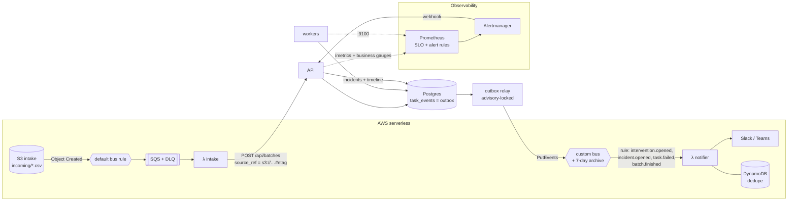

# PortalPilot architecture

An agent that operates enterprise web portals that have no API, for example filing insurance claims from a client's
CSV into a legacy provider portal. It is built for the three things that go wrong in that kind of work:

* **Perception**: the portal has no stable selectors, so the agent has to *see* the page.
* **Side effects**: pressing "Submit claim" twice files two claims, and timeouts are common.
* **Humans**: MFA prompts, approvals and pages the agent has never seen all need a person, without losing progress.

Contents: [1. System architecture](#1-system-architecture) · [2. PostgreSQL schema](#2-postgresql-schema) ·
[3. Temporal workflow design](#3-temporal-workflow-design) · [4. Operator Control & Replay Studio](#4-operator-control--replay-studio) ·
[5. AWS deployment](#5-aws-deployment) · [6. Measured results](#6-measured-results) ·
[7. Events, operations and Kubernetes](#7-events-operations-and-kubernetes)

---

## 1. System architecture

```mermaid
flowchart LR
  subgraph Operator
    UI[React/TS Studio]
  end
  subgraph Control plane
    API[FastAPI<br/>onboarding · signals · replay]
    T[(Temporal)]
    PG[(PostgreSQL<br/>tasks · steps · ledger · audit)]
    S3[(S3<br/>screenshots)]
  end
  subgraph "Worker (N replicas)"
    W[Workflows + DB activities<br/>shared queue]
    B[Browser activities<br/>private queue per worker]
    PW[Playwright / Chromium]
    R{Grounding router}
  end
  subgraph Grounding tiers
    C[(cache<br/>Postgres)]
    Q[Qwen2-VL-2B<br/>GRPO click policy<br/>vLLM, GPU]
    CL[Claude<br/>fallback]
  end
  P[[Legacy portal<br/>no API]]

  UI -- REST --> API
  UI <-. WebSocket .- API
  API -- start workflow / signal / query --> T
  API --> PG
  PG -. LISTEN/NOTIFY .-> API
  T <--> W
  T <--> B
  W --> PG
  B --> PW --> P
  B --> R
  R --> C
  R --> Q
  R --> CL
  B --> S3
  B --> PG
```

**How a request flows.**
1. An operator uploads a CSV. The API maps messy headers to the claim schema, normalizes values, derives an
   **idempotency key** per row and writes `batches` and `tasks`. Rows that fail validation are stored as `invalid`
   tasks with field-level errors, never dropped. The API then starts a `BatchWorkflow`.
2. The `BatchWorkflow` starts one `ClaimTaskWorkflow` child per task (workflow id `task-<id>`), at most
   `max_concurrency` at a time. The fragile portal and the client's rate limit set that cap.
3. `ClaimTaskWorkflow` asks any worker to `open_session`. That worker creates a browser context and returns its
   **private task queue**, and every later browser activity for this task is routed to that queue, so the session
   stays on the worker that holds it.
4. Each playbook stage (`login → dedupe_check → fill_policy → fill_claimant → fill_incident → review → submit`) is one
   activity. Inside it, each action asks the **grounding router** for a point, has the **verifier** check it,
   performs the action and records a step: screenshots before and after, the grounding trace, the point, and the
   bounding box of the verified element.
5. Workers write `task_events` and `pg_notify`. Each API replica `LISTEN`s and fans events out to WebSocket
   subscribers, which keeps the Studio live without Redis.

**Grounding: cheap first, verified always.**

| Tier | What | Cost | When it answers |
|---|---|---|---|
| `cache` | point from an earlier success on a page with the same *structural* DOM hash | free, ~1 ms | 2nd+ row of a batch on the same page |
| `qwen` | **my fine-tuned Qwen2-VL-2B click policy** ([ui-click-rl](https://github.com/snehabasker/ui_click_grpo)), served by vLLM, prompted exactly as it was trained | ≈ free (own GPU) | most actions |
| `claude` | `claude-opus-5-5`, structured JSON output, effort `low`, server-side refusal fallback | $ | only what the cheaper tiers got wrong |
| `dom` | Playwright accessibility locators | free | CI / no-GPU; an optional last resort |

The **verifier** is the confidence signal for every tier. Before anything is clicked it runs `elementFromPoint`
at the proposed pixel and checks three things: the element is the right *kind* (button, input, select, link), its
accessible name contains the expected text, and no modal is covering it. A small model's near-miss (it clicked the
label cell beside the field) therefore becomes an escalation instead of a wrong click. Any tier that produces a
verified point writes it to the cache. The cache key is a hash of the page *structure* (tags, roles, labels and
positions, not field values), so every row of a batch shares the login-page entry.

**Why playbooks instead of a free-roaming agent?** The stage order, the success checks and the submit guard are
code: reviewable, testable and auditable, which is what a client's risk team will ask for. The models do
perception. Swapping in an LLM planner for unknown pages is a contained change to one stage. It does not touch
the guarantees.

---

## 2. PostgreSQL schema

Full DDL: [`backend/portalpilot/migrations/001_init.sql`](../backend/portalpilot/migrations/001_init.sql).
Temporal owns execution state; these tables are the system of record for everything a human or auditor sees.

| Table | Role | Key design points |
|---|---|---|
| `tenants` | tenancy root | |
| `credentials` | **credential vault** | Envelope encryption: secret encrypted with a per-row DEK (Fernet), and the DEK wrapped by a master key (local key in dev, **AWS KMS** in prod). Plaintext never reaches this table, logs or Temporal history. Decryption is audited. |
| `batches` | one CSV upload | stored `column_mapping` records *how* each header was mapped (synonym / fuzzy / llm), so a human can review it |
| `tasks` | **the work queue** | `UNIQUE (tenant_id, idempotency_key)`: re-uploading a file cannot create work twice. `raw_row` + `payload` keep lineage. `validation_errors` for invalid rows. |
| `submit_ledger` | **zero-double-submit state machine** | `intent → in_flight → confirmed`, or `in_flight → reconciled_found / reconciled_absent`. The worker can press submit only after an atomic `UPDATE … SET state='in_flight' WHERE state='intent'`. A second click without a reconcile is impossible even if the workflow code is wrong. |
| `screenshots` | what the agent saw | content-addressed by sha256 (identical frames stored once), plus `dom_hash` and URL |
| `task_steps` | **durable step checkpoints** | `UNIQUE (task_id, step_key)` with `step_key = stage/run/attempt/index`: a duplicated activity delivery upserts instead of creating phantom steps. Stores grounding trace (every tier's point, verdict, latency and cost), point, verified bbox, before/after screenshots, actor (agent or `operator:<name>`). |
| `grounding_cache` | perception cache | `(dom_hash, instruction_hash)` → point. Hits and misses are counted, and an entry with 3 failed verifications stops being served. |
| `interventions` | **human-in-the-loop states** | kinds: `approval`, `mfa_code`, `takeover`, `grounding_failure`, `unexpected_page`. Status `open → resolved / expired / cancelled`, deadline, resolver, resolution (never secrets) |
| `intervention_secrets` | values a human typed for the agent | sealed MFA codes; the Temporal signal carries only the intervention id, and the worker consumes the code once |
| `task_events` | live stream + replay log | API LISTENs on `task_events` and pushes over WebSockets |
| `audit_log` | **tamper-evident audit** | append-only (UPDATE/DELETE raise) and **hash-chained**: each row's sha256 covers the previous row's hash. Records credential decryptions, ledger transitions, approvals and operator actions. |

---

## 3. Temporal workflow design

Code: [`orchestration/workflows.py`](../backend/portalpilot/orchestration/workflows.py). Tests:
[`tests/test_workflow.py`](../backend/tests/test_workflow.py) (12 scenarios in Temporal's time-skipping test server).

```mermaid
stateDiagram-v2
  [*] --> login
  login --> mfa_wait: portal asks for code
  mfa_wait --> login: signal input_provided
  login --> dedupe_check
  dedupe_check --> [*]: found on portal (reconciled_found)
  dedupe_check --> fill_policy
  fill_policy --> fill_claimant --> fill_incident --> review
  review --> approval_wait: amount > threshold
  approval_wait --> submit: approve
  approval_wait --> [*]: reject / deadline
  review --> submit
  submit --> [*]: confirmed
  submit --> dedupe_check: outcome unknown (timeout / no confirmation)
  note right of submit: one-shot activity, ledger intent→in_flight
```

**Retries.** Each stage activity uses an exponential-backoff retry policy (2 s → 30 s, 3 attempts) for transient
trouble: maintenance pages, slow loads, navigation races. Non-retryable failures are typed and handled by the
workflow: `InvalidData` and `BadCredentials` end the task; `GroundingFailed` hands control to a human;
`SubmitOutcomeUnknown` triggers a reconcile; `SessionLost` reopens a browser elsewhere. DB activities retry up to
10 times. They are idempotent by construction (upserts, conditional transitions).

**Idempotency: zero double-submits.** There are four layers, each independent of the others:
1. `tasks UNIQUE (tenant, idempotency_key)`: the same row can never become two tasks.
2. Child workflow id `task-<id>`: Temporal refuses to start the same task twice.
3. The key is typed into the portal's own "Your reference" field, and **every path to the submit button runs
   `dedupe_check`**, which searches the portal for it. This includes the path after a crash, a session loss, a
   human takeover, or a submit whose outcome is unknown. The portal is the source of truth.
4. The submit stage is a **one-shot** activity (no retry), and the worker must win the ledger transition
   `intent → in_flight` in SQL before clicking. An unknown outcome leaves the ledger `in_flight`; only a reconcile
   can move it on.

**Session affinity and crash recovery.** Browser activities run on the private queue of the worker that holds the
session, with `schedule_to_start = 30 s` and `heartbeat = 45 s`. When a worker dies, the next browser activity
fails one of those timeouts, the workflow opens a new session on another worker and restarts at `login`, which leads
into `dedupe_check`. Steps cut off mid-flight are marked `interrupted` in the replay.

**Long pauses for humans.** Approvals, MFA codes and takeovers are signals plus `workflow.wait_condition` with a
deadline: approval 72 h, MFA 24 h, takeover 24 h. A waiting workflow holds no worker slot and no browser time. On a
deadline the task ends `expired` and the intervention is closed. A takeover can interrupt any other wait, and the
workflow restores that wait when the operator hands back.

**Takeover protocol.** Signals: `request_takeover` → `operator_action` (click x,y / type / key / navigate / refresh,
executed on the session's worker) → `release(mode = retry | skip)`. Because a human had the browser, the workflow
sets `needs_reconcile`, and the next submit is preceded by a `dedupe_check`, in case the operator pressed submit
themselves.

**What stays out of Temporal history.** Passwords and MFA codes. Credentials are referenced by id and decrypted
inside the activity. MFA codes are sealed in `intervention_secrets` and the signal carries only the id. Workflow
history can therefore be exported or shown to a client.

---

## 4. Operator Control & Replay Studio

React 19 + TypeScript, no UI framework. Code: [`frontend/src`](../frontend/src).

| View | What it shows |
|---|---|
| **Batches** | CSV drop zone, then a **column-mapping preview** (each header → field, with method and confidence) and a row table with errors and warnings (e.g. "ambiguous date 03/04/2026; read as 2026-04-03") before anything runs. Pick the portal login, approval threshold and concurrency, then run. |
| **Batch detail** | live table of rows: status, stage, idempotency key, claim number, cost, errors |
| **Replay Studio** (per task) | stage bar · **step timeline** grouped by stage with a badge for the grounding tier · **screenshot stage** with an SVG overlay drawn in the screenshot's own pixel space: winning click point (crosshair, coloured by tier), **verified element bounding box**, and every **rejected** tier's point as a red ✕ · before/after toggle · filmstrip · **step inspector** with the full grounding trace (tier, point, verdict, reason, ms, $) · **submit ledger** card · live Temporal workflow history |
| **Take Over** | one button. The stage switches to the live browser frame (yellow outline); a click on the image becomes an operator click at that pixel in the real browser. Type box, Enter/Tab/Escape, Refresh. "Hand back: retry stage" or "Hand back: I finished this stage". |
| **Approvals / MFA** | inline in the Studio and collected on **Needs attention**: the review-page screenshot with Approve/Reject plus a note; an MFA code box (sealed server-side) |
| **Metrics** | claims submitted, **submit clicks vs claims** (equal means no click was repeated), unknown outcomes recovered by reconcile, grounding spend per claim, small-model rejections and Claude rescues, tier share with latency and cost |

Live updates: one WebSocket per view (`/api/ws?task_id=…`) carrying `step.started`, `step.finished`,
`stage.*`, `intervention.*` and `task.updated` events, with reconnect and backoff. The Studio also polls the
Temporal query `state` while a task is alive, for takeover state and the latest frame.

---

## 5. AWS deployment

Terraform in [`infra/terraform`](../infra/terraform), one state and one `clients/<name>.tfvars` per client
(FDE-style: deploy into the client's own account).

* **Network**: VPC across 2 AZs, ALB, ECS tasks in public subnets with locked-down security groups (no NAT, a
  demo-cost tradeoff that is documented), RDS in private subnets reachable only from the app security group.
* **Compute**: ECS Fargate services `api`, `worker` (Chromium, `stopTimeout` 60 s), `web` (nginx static), `temporal`
  (auto-setup on the same RDS; set `temporal_address` to use Temporal Cloud instead), optional mock `portal`.
  Cloud Map private DNS for service-to-service calls. Deployment circuit breaker with rollback.
* **Data**: RDS PostgreSQL 16 (encrypted, 7-day backups, Performance Insights), S3 for screenshots (private, SSE,
  90-day expiry), KMS key with rotation as the vault master key, Secrets Manager for DB URL, operator token and
  Anthropic key.
* **IAM**: execution role (pull, logs, read one secret) is separate from the task role, which can reach one bucket and
  `GenerateDataKey/Decrypt` on one key.
* **Ops**: CloudWatch log groups per service, an alarm on API 5xx, an alarm on "no running workers", SNS email.
* **GPU tier**: the Qwen tier is a URL (`qwen_url`). For AWS, serve the merged checkpoint with vLLM on a `g6.xlarge`
  (or SageMaker) and point `qwen_url` at it. That part is not provisioned by this Terraform.

`./scripts/deploy.sh <client>` builds and pushes the images to ECR, then applies. It needs only Docker:
terraform and the AWS CLI run from their official images.

---

## 6. Measured results

All numbers come from runs on one laptop (RTX 5050 8 GB) against the mock portal; see the README for exact commands.

**Grounding eval** (`e2e/grounding_eval.py`): the full claim flow at 3 viewport sizes with pop-ups on, 69 controls.

| tier | verified clicks | p50 latency |
|---|---|---|
| Qwen2-VL-2B (my GRPO policy, never trained on this portal) | **63 / 69 (91.3%)** | 1.5 s |
| DOM (reference) | 69 / 69 | 42 ms |

All 6 Qwen misses have the same shape: the click landed on the **label cell next to a text field**. The verifier
rejected each one before anything was clicked, so with the router they escalate to the next tier instead of
becoming a wrong click.

**End-to-end, hostile portal** (`e2e/run_e2e.py --chaos`): 30% pop-ups, 10% 503 pages, MFA on every sign-in, and
one submit that saves the claim and then hangs for 90 s. Chain `cache → qwen → dom`, 3 concurrent browsers.

| check | result |
|---|---|
| valid rows filed | 4 / 4 (2 invalid rows rejected at onboarding, never attempted) |
| claims on the portal / submit clicks | 4 / 4 (no duplicates) |
| hung submit | outcome unknown → portal search found it → `reconciled_found`, **no second click** |
| who grounded the 99 actions | qwen 58 · cache 34 · dom fallback 7 |
| re-upload of the same CSV | 0 tasks started |

**Worker crash**: SIGKILL of the only worker mid-batch, then a new worker started. The 3 in-flight tasks opened new
sessions on the new worker, re-logged in, ran the dedupe check and finished. 4 claims, 4 clicks.

**On AWS**: deployed with `./scripts/deploy.sh demo` to ECS Fargate + RDS + KMS + ALB in `eu-north-1`, the same
`run_e2e.py --chaos` against the load balancer passes all 8 checks (4 claims / 4 clicks, the hung submit reconciled).
The cache and DOM tiers were used there, since that stack has no GPU.

Not measured here: the Claude tier live (wired and unit-tested; it needs an API key and spends money), and Qwen on AWS
(needs a GPU endpoint).

---

## 7. Events, operations and Kubernetes

Added 2026-11-06. Decisions: [ADR 0009](adr/0009-event-driven-intake-and-notifications.md) (events),
[0010](adr/0010-helm-chart-alongside-terraform.md) (Helm), [0011](adr/0011-slos-prometheus-and-incidents-in-product.md)
(SLOs and incidents), [0012](adr/0012-design-tokens-with-contrast-checks.md) (design system).



**Inbound.** A CSV under `incoming/` in the intake bucket becomes a batch with no human upload. SQS sits between
EventBridge and the Lambda to absorb bursts, retry per message and dead-letter after 3 receives. The function reports
partial batch failures. `batches.source_ref` (unique per tenant) makes redelivery idempotent, and a redelivery also
starts a batch whose first attempt died before starting its workflow. A 4xx from the API is written back as
`rejected/<file>.error.json` and is not retried.

**Outbound.** `task_events` doubles as an outbox. The relay maps a small public set of event types, publishes them in
id order in chunks of 10 (stopping at the first rejected entry so ordering survives a retry), and advances
`outbox_cursor`. Delivery is at-least-once end to end, so consumers dedupe on `event_id` (the notifier uses a
DynamoDB conditional put and releases the claim if the webhook call fails).

**Metrics.** Counters and histograms per process (stage outcomes and durations, grounding attempts by tier and
verdict, ledger transitions, HTTP), plus gauges the API reads from Postgres at scrape time: task states, open
interventions and their age, **double-submit suspects** (ledger rows with more than one click), submits stuck in
flight, and outbox lag. Labels are bounded (stage, tier and route *templates*, never ids).

**SLOs and alerts.** API availability 99.5 % and perception 99 %, with multi-window burn-rate alerts. Invariant
alerts page on any non-zero value. Rules are unit-tested with promtool, and the Helm chart ships the same files as
a `PrometheusRule`. Grafana dashboards are generated from Python: an on-call overview and agent internals.

**Incidents.** Alertmanager posts to `/api/incidents/alertmanager`. There is one open incident per alert
fingerprint, with a timeline of fired, acknowledged, notes, resolved and auto-resolved events. Operators work it
in the Studio's Incidents page, and each change is also a domain event, so `incident.opened` reaches chat through
the notifier. Runbooks: [docs/ops](ops/README.md).

**Kubernetes.** The Helm chart runs the application tier against bring-your-own Postgres, Temporal and S3 (bundled
dev versions for kind/CI). Workers get a memory-backed `/dev/shm`, a 75 s grace period, a PDB, and optional HPA. All
pods are non-root with capabilities dropped. NetworkPolicy, ServiceMonitor, PrometheusRule and Ingress are opt-in.

**Game day** ([postmortem](ops/postmortems/2026-11-06-game-day.md)). A portal outage (85 % 503s) and a worker
SIGKILL, injected into the full stack: both detected, opened as incidents, acknowledged and resolved; 14 claims for
14 clicks. It found that tasks waiting on a human hold the batch's concurrency slots
([ADR 0013](adr/0013-human-waits-do-not-hold-concurrency.md)), and that the outage alert lagged the stuck tasks by
about 5 minutes. The new `StuckTasksBurst` alert, plus a fix for lazily created counters, cut detection to 1 min 47 s
in the verification run (16 of 16 tasks, 16 claims for 16 clicks).
